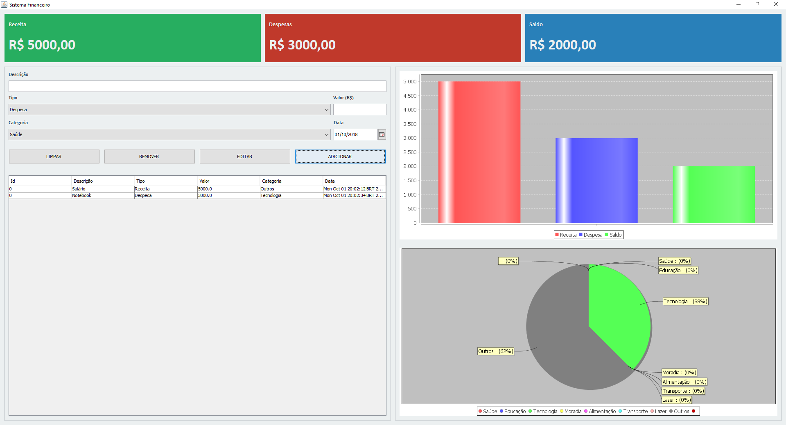

# Financial Control

Java desktop financial-control application developed for programming classes.

## Getting started

- Open the tracked Java project as an existing project in NetBeans.

- Inspect the project libraries and original course notes before using Build or Run; historical external libraries may need to be restored.

## Recorded requirements

- A JDK and NetBeans compatible with the tracked Ant project configuration.

## Repository map

- [build.xml](https://github.com/kleberandrade/controle-financeiro/blob/master/build.xml)
- [nbproject/project.xml](https://github.com/kleberandrade/controle-financeiro/blob/master/nbproject/project.xml)

## Validation status

This update documents the tracked source and project metadata. It does not certify a successful build, device test or compatibility with a current toolchain. Follow any project-specific validation instructions in the original material.

## License and attribution

See [LICENSE](https://github.com/kleberandrade/controle-financeiro/blob/master/LICENSE) and any notices accompanying third-party code and assets. This documentation update does not change licensing or authorship.

---

## Original project material

# Controle Financeiro

Disciplina do terceiro semestre do curso de Análise e Desenvolvimento de Sistemas na Unisal Campinas.

## Ferramentas

*   [Netbeans 8.0.2](https://netbeans.org/downloads/8.0.2/)

## O sistema desenvolvido

  

## Links interessantes

## Licença

    Copyright 2019 Kleber de Oliveira Andrade
    
    Permission is hereby granted, free of charge, to any person obtaining a copy
    of this software and associated documentation files (the "Software"), to deal
    in the Software without restriction, including without limitation the rights
    to use, copy, modify, merge, publish, distribute, sublicense, and/or sell
    copies of the Software, and to permit persons to whom the Software is
    furnished to do so, subject to the following conditions:
    
    The above copyright notice and this permission notice shall be included in all
    copies or substantial portions of the Software.
    
    THE SOFTWARE IS PROVIDED "AS IS", WITHOUT WARRANTY OF ANY KIND, EXPRESS OR
    IMPLIED, INCLUDING BUT NOT LIMITED TO THE WARRANTIES OF MERCHANTABILITY,
    FITNESS FOR A PARTICULAR PURPOSE AND NONINFRINGEMENT. IN NO EVENT SHALL THE
    AUTHORS OR COPYRIGHT HOLDERS BE LIABLE FOR ANY CLAIM, DAMAGES OR OTHER
    LIABILITY, WHETHER IN AN ACTION OF CONTRACT, TORT OR OTHERWISE, ARISING FROM,
    OUT OF OR IN CONNECTION WITH THE SOFTWARE OR THE USE OR OTHER DEALINGS IN THE
    SOFTWARE.
