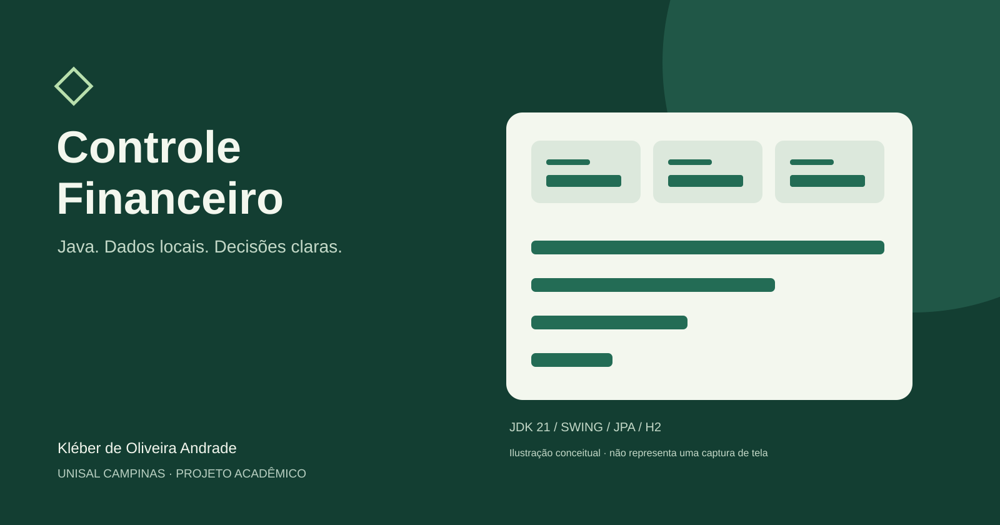
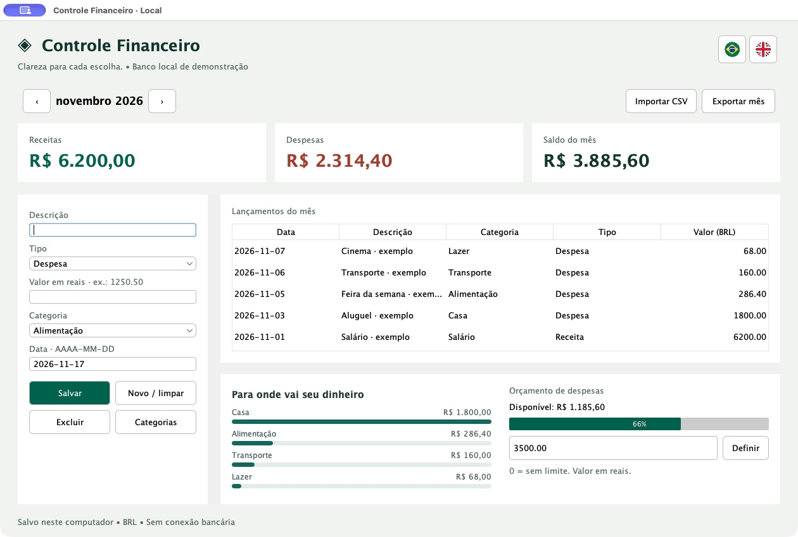
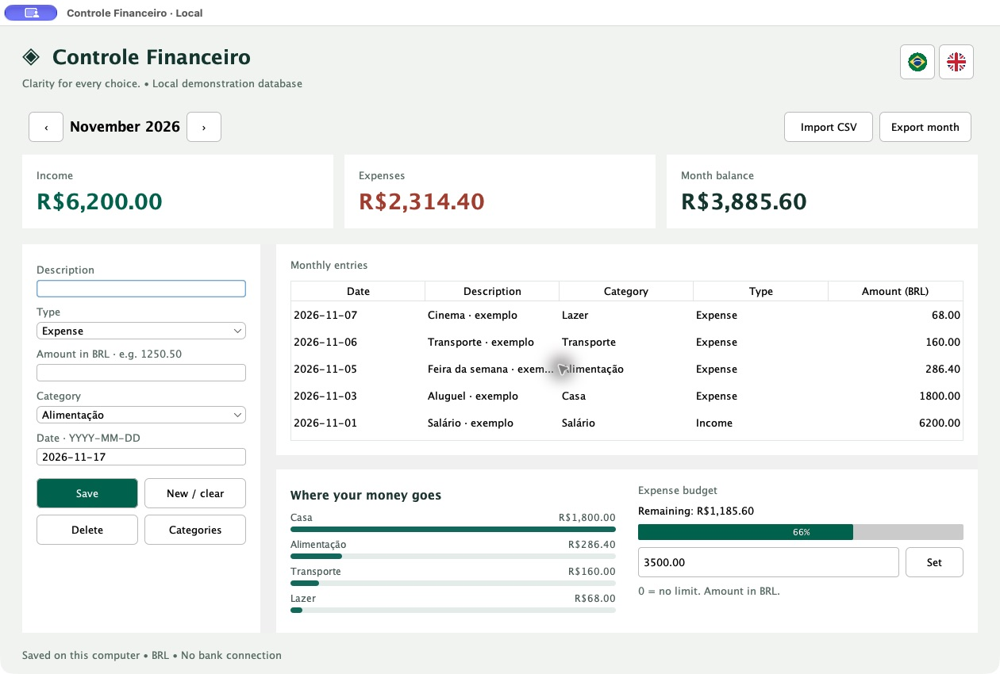

# Controle financeiro em Java: do lançamento à persistência local

**Autoria original: Kléber de Oliveira Andrade. Contexto: terceiro semestre de Análise e Desenvolvimento de Sistemas, Unisal Campinas. Revisão preparada em 17 de novembro de 2026.**

> Revisão editorial local, ainda não publicada. O repositório não informa uma URL de aula no Medium. A busca pública focada não identificou uma aula própria vinculada. A sessão editorial do Medium estava disponível; a busca “controle financeiro”, filtrada pelo autor, retornou apenas uma narrativa de ficção sem relação com este projeto. O bloqueio é a identificação da URL da aula original, não a autenticação. Antes de publicar, vincule esta revisão ao artigo original, preserve URL, idioma, autoria e créditos, e confira capa, imagens e blocos de código na página publicada. Não criar um artigo substituto por suposição nem enviar newsletter.



*Nova capa vetorial conceitual, desenhada localmente. Esta ilustração não é uma captura do aplicativo.*

## O que vamos construir

Um aplicativo desktop de receitas e despesas com editor, tabela mensal, totais, gráfico por categoria e orçamento. Java Swing continua sendo a interface; Jakarta Persistence e EclipseLink continuam responsáveis pelos lançamentos. O banco H2 funciona no próprio computador, sem servidor MySQL ou usuário root.

O objetivo da aula é observar a ligação entre uma regra do domínio, uma transação no banco e uma resposta na tela. Não há autenticação online nem conexão bancária. Use dados inventados durante o aprendizado.



*Captura atual da aplicação executando no macOS. A demonstração tem receita de R$ 6.200,00, despesas de R$ 2.314,40 e saldo de R$ 3.885,60. Esses números são exemplos sintéticos.*

## 1. Preparar um ambiente que outra pessoa consiga reproduzir

Instale um JDK 21 e configure `JAVA_HOME` e `PATH` para ele. Use o Maven Wrapper versionado no projeto, que baixa Maven 3.10.1 e verifica seu SHA-256:

```sh
git clone https://github.com/kleberandrade/controle-financeiro.git
cd controle-financeiro
./mvnw --batch-mode verify
java -Dfinance.dataDir=./data/demo -jar target/controle-financeiro-1.0.0.jar --demo
```

No Windows, troque `./mvnw` por `mvnw.cmd`. A primeira compilação precisa acessar o Maven Central. O comando `verify` verifica formatação, compila com avisos habilitados, executa testes e gera o JAR e o relatório de cobertura.

O conjunto validado usa EclipseLink 5.0.2, Jakarta Persistence 3.2.0, H2 2.5.252, FlatLaf 3.8, Commons CSV 1.14.1, Commons IO 2.22.0, Commons Codec 1.23.0 e JUnit 6.1.3. As versões dos plugins estão em `pom.xml`. Não substitua essas versões por releases de teste sem repetir a validação.

A pasta indicada por `finance.dataDir` guarda o banco. `--demo` cria cinco exemplos e um orçamento de R$ 3.500,00 quando o banco está sem lançamentos. Sem essa opção, o aplicativo inicia com um livro vazio. Se apagar todos os exemplos e executar novamente com `--demo`, eles serão criados outra vez.

## 2. Modelar dinheiro e datas antes de escrever a interface

O arquivo `src/main/java/br/unisal/aula/model/RegistroFinanceiro.java` concentra os limites do domínio. Descrição e categoria são obrigatórias, com limites de 160 e 60 caracteres. O tipo só pode ser `RECEITA` ou `DESPESA`.

Dinheiro usa `BigDecimal`, construído a partir de texto. Nunca converta um `double` para tentar recuperar os centavos. O teste `moneyAndDatesAreExact` verifica que receitas de 0,10 e 0,20 menos uma despesa de 0,05 resultam exatamente em 0,25.

Trecho do método de validação monetária, presente no código final:

```java
try {
  return value.setScale(2, RoundingMode.UNNECESSARY);
} catch (ArithmeticException e) {
  throw new IllegalArgumentException(
      "Use até 2 casas decimais / Use at most 2 decimal places.", e);
}
```

O restante desse método rejeita valor negativo, valor zero em um lançamento e quantias acima de 999.999.999.999,99. Um orçamento permite zero porque esse valor significa “sem limite”. A aplicação não arredonda silenciosamente uma entrada como `1.001`.

`LocalDate` representa o dia do lançamento sem inventar um horário. O formato de entrada é `AAAA-MM-DD`; dias inexistentes como `2026-02-30` são rejeitados. O domínio limita os anos a 0001–9999. `YearMonth` representa o filtro mensal e evita misturar novembro de anos diferentes.

## 3. Separar cálculo, armazenamento e apresentação

`FluxoCaixa` calcula receitas, despesas, saldo e despesas por categoria a partir de uma lista. Esses cálculos não precisam abrir uma janela ou conectar ao banco. O saldo é receita menos despesa; o orçamento disponível é limite menos despesa. Uma receita não consome o orçamento de despesas.

`FinanceRepository` define as operações de armazenamento. A implementação `LocalDatabase` usa JPA para lançamentos e comandos parametrizados para categorias e orçamento. Essa separação permite trocar o repositório sem colocar consultas SQL dentro dos componentes Swing.

A interface `PrincipalFrame` carrega dados, apresenta os resultados e transforma os campos em um objeto validado. Operações de banco e arquivo rodam em `SwingWorker`; alterações dos componentes ocorrem na thread de eventos. Durante uma operação, botões de ação ficam desabilitados e a tela informa que está trabalhando.

## 4. Controlar o esquema e as transações

O esquema inicial está em `src/main/resources/db/V1__ledger.sql`. A tabela de lançamentos contém uma sequência de identificadores, descrição, tipo, valor decimal, chave de categoria e data. Uma chave estrangeira impede referências a categorias inexistentes. As tabelas `categories`, `entries` e `budgets` têm responsabilidades diferentes.

O arquivo `META-INF/persistence.xml` usa Jakarta Persistence 3.2 e desabilita a geração automática de tabelas pelo ORM. O programa consulta `schema_version`, aplica V1 quando necessário e grava a versão ao final. Como DDL do H2 faz commit automático, os comandos iniciais são idempotentes: uma inicialização interrompida pode ser repetida. Esse executor é pequeno e específico para V1; para uma nova versão, implemente uma etapa explícita e teste a atualização. Não altere uma migração que já tenha sido distribuída.

Cada escrita abre uma transação, confirma ao concluir e desfaz ao receber uma exceção. Os erros chegam à interface em vez de serem impressos e ignorados como se a gravação tivesse funcionado. Um `EntityManager` não é compartilhado entre threads.

Um teste usa um banco em pasta temporária, grava uma despesa e o orçamento, fecha a conexão, abre novamente e verifica os dados. Outros testes confirmam que uma categoria em uso não pode ser removida, que a remoção de uma categoria livre persiste após reiniciar e que uma versão futura do esquema é recusada sem apagar lançamentos.

Para fazer backup, feche o aplicativo e copie a pasta inteira do banco. Um CSV não contém categorias sem lançamentos nem os orçamentos. Não copie o arquivo de um banco aberto como se fosse um backup consistente.

## 5. Usar o editor e compreender os estados da tela

Preencha descrição, tipo, valor, categoria e data. O campo de valor aceita `1250.50` ou `1250,50`, sem separador de milhar. Salvar cria um lançamento; selecionar uma linha e salvar novamente edita o item. “Novo / limpar” volta ao modo de inclusão. Excluir pede confirmação.

A data determina o mês em que o registro aparece. Se cadastrar uma data de outubro enquanto visualiza novembro, o item será salvo, mas aparecerá na tabela de outubro. Categorias são compartilhadas entre os meses. O orçamento pertence ao mês e ano selecionados.

O gráfico mostra as quatro categorias com maior despesa; a tabela contém todos os lançamentos do mês. A barra de orçamento chega a 100% visualmente, mas o texto continua mostrando o percentual e o valor disponível negativo quando há excesso. Em um mês vazio, os totais são zero e a tela apresenta uma orientação para começar.



*Trocar o idioma altera os rótulos e a formatação, preservando os lançamentos e os campos preenchidos. A moeda permanece BRL. As bandeiras circulares são desenhos locais com tooltip e rótulo acessível.*

A verificação da interface real incluiu inclusão de R$ 12,50, mudança de idioma com o formulário preenchido, edição para R$ 20,00 e exclusão confirmada do dado sintético. Os totais acompanharam essas mudanças e retornaram ao valor original após a exclusão. A tabela fornece uma alternativa textual ao gráfico. A aplicação possui rótulos acessíveis, mas isso não equivale a uma auditoria completa com leitor de tela.

## 6. Importar e exportar sem perder consistência

O exemplo `examples/transactions.csv` usa o contrato abaixo:

```csv
date,type,description,category,amount
2026-11-01,RECEITA,Salário de exemplo,Salário,6200.00
2026-11-03,DESPESA,Aluguel de exemplo,Casa,1800.00
```

Os nomes e a ordem do cabeçalho são exatos. Os tipos permanecem em português mesmo na interface em inglês. Valores usam ponto decimal e datas ISO. Crie as categorias antes da importação. O teste `realCsvExampleImportsAndExportsAcrossRestart` importa esse arquivo, verifica saldo de R$ 4.400,00, reabre o banco e confere a exportação.

Commons CSV interpreta campos com vírgula, aspas e quebras de linha conforme RFC 4180. O aplicativo valida o arquivo inteiro antes de gravar e importa tudo em uma transação. Arquivos acima de 5 MB, mais de 10 mil registros, cabeçalho incorreto, datas ou valores inválidos e categorias desconhecidas são rejeitados. Ao corrigir o arquivo e tentar novamente, os registros anteriores ao erro não estarão duplicados por uma gravação parcial.

A importação pede confirmação após mostrar a quantidade de registros. Reimportar um arquivo válido adiciona novos registros: não é uma sincronização e não há deduplicação automática.

Planilhas podem interpretar textos iniciados por `=`, `+`, `-` e `@` como fórmulas. A exportação protege esses textos com apóstrofo, inclusive quando há espaços antes do marcador; apóstrofos originais são duplicados. A importação reverte essa convenção própria do aplicativo, e qualquer exportação posterior aplica a proteção novamente. Examine o arquivo também como texto e não habilite macros ou conteúdo externo de planilhas.

## 7. Validar e reconhecer os limites

Execute novamente:

```sh
./mvnw verify
```

Os onze testes usam dados sintéticos e bancos temporários. Cobrem validação, centavos exatos, cálculos, persistência, alterações, orçamento, isolamento de mês/ano, rollback de importação, CSV malformado, limites e proteção do esquema. O relatório fica em `target/site/jacoco/index.html`. Cobertura do núcleo não deve ser apresentada como cobertura da interface inteira.

O JAR e uma imagem nativa com runtime Java foram executados no macOS ARM64. Não foram validados instaladores Windows/Linux, dispositivos móveis, migração automática do MySQL legado nem uma distribuição assinada. O layout compacto existe no código, mas a redução da janela não pôde ser confirmada pela ferramenta de inspeção nesta sessão. Consulte `docs/VALIDATION.md` para os resultados e limites observados.

O banco local não tem autenticação do aplicativo nem criptografia configurada. Ele depende das permissões da conta do sistema operacional e é destinado à demonstração acadêmica. Não use esta aula como proposta de uma fintech ou serviço multiusuário de produção.

## Referências e créditos

- [Repositório e código verificado](https://github.com/kleberandrade/controle-financeiro).
- [Jakarta Persistence 3.2](https://jakarta.ee/specifications/persistence/3.2/).
- [EclipseLink](https://eclipse.dev/eclipselink/) e [H2](https://h2database.github.io/).
- [SwingWorker, Java 21](https://docs.oracle.com/en/java/javase/21/docs/api/java.desktop/javax/swing/SwingWorker.html), [BigDecimal](https://docs.oracle.com/en/java/javase/21/docs/api/java.base/java/math/BigDecimal.html) e [LocalDate](https://docs.oracle.com/en/java/javase/21/docs/api/java.base/java/time/LocalDate.html).
- [Commons CSV](https://commons.apache.org/proper/commons-csv/) e [FlatLaf](https://www.formdev.com/flatlaf/).
- Projeto original por Kléber de Oliveira Andrade, Unisal Campinas, 2019, sob licença MIT. A captura histórica e os fontes originais permanecem no repositório e no histórico. As novas capturas mostram dados sintéticos; a capa é uma ilustração vetorial conceitual.

## Exercícios práticos

1. **Conferir os centavos.** Cadastre receitas de R$ 0,10 e R$ 0,20 e uma despesa de R$ 0,05 em um banco vazio. Conclua quando a tela mostrar saldo de R$ 0,25 e um teste automatizado confirmar o mesmo valor após reabrir o banco.
2. **Separar meses e anos.** Cadastre despesas em novembro de dois anos diferentes e defina um orçamento para apenas um deles. Conclua quando cada tabela e cada orçamento aparecerem apenas no mês/ano correspondente, com teste de regressão.
3. **Testar uma importação indivisível.** Prepare um CSV com duas linhas válidas e uma terceira com data inexistente. Conclua quando a importação informar o erro sem alterar a quantidade de registros; corrija a data e demonstre a inclusão das três linhas.
4. **Proteger uma exportação.** Inclua descrições com vírgula, aspas, quebra de linha, apóstrofo e `=1+1`. Conclua quando a exportação estiver protegida para planilha e a reimportação recuperar os textos e centavos sem executar conteúdo externo.
5. **Evoluir o esquema com recuperação.** Em uma cópia do banco, projete V2 para adicionar uma observação opcional. Conclua quando os testes preservarem lançamentos, categorias e orçamentos de V1, repetirem a abertura sem duplicações e recusarem uma versão futura desconhecida.
